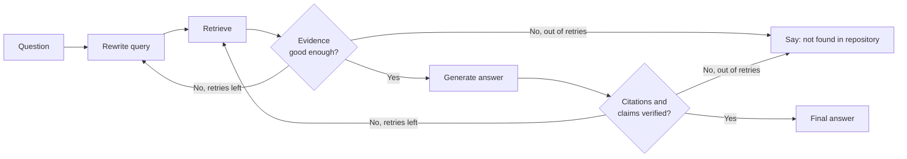

# RAG Implementation Plan (Reference)

A short, optional reference for the Developer Knowledge & Codebase Assistant. It summarises the concepts we need to understand before and during implementation, and links them back to earlier design documents:

- `module-1-architecture.md`: pipelines, revision tracking, citations, stale-index and conflict handling
- `module-2-chunking.md`: chunking strategy

No code is included. Numbers (such as k or thresholds) are starting points to be tuned through evaluation.

---

## 1. Embeddings

**What they are.** An embedding model converts a piece of text (or code) into a list of numbers, a *vector*, usually a few hundred to a few thousand dimensions. Texts with similar meaning end up close together in this vector space, even if they share no words. For example, "how do users sign in?" lands near a chunk about `login()`.

**How similarity is measured.** We compare two vectors with a distance or similarity measure. The most common is **cosine similarity**, which looks at the angle between vectors (1 means same direction, near 0 means unrelated). Dot product and Euclidean distance are alternatives.

**Things to keep in mind**
- The **same embedding model** must be used for chunks (ingestion) and questions (query). Changing the model means re-embedding everything.
- Models have an **input length limit**, which is one reason we chunk.
- Embeddings capture *meaning*, not exact tokens. They can miss exact identifiers such as `MAX_FAILED_ATTEMPTS` or an error code (this motivates hybrid search, Section 4).
- A model trained on both text and code is preferable, since our corpus is a mix of code and documentation.

---

## 2. Vector Stores

**What they store.** For every chunk, a vector store keeps three things together:

| Item | Purpose |
|---|---|
| **Vector** | Used for similarity search |
| **Chunk text** | What we give to the LLM and quote in citations |
| **Metadata** | `file_path`, `commit_sha`, `start_line`, `end_line`, `source_type`, `class`/`method` or `heading_path`, `last_modified` (see Modules 1 and 2) |

**How they are searched.** Comparing a question against every vector is slow at scale, so stores use **approximate nearest neighbour (ANN)** indexes (such as HNSW), which trade a tiny amount of accuracy for large speed gains. Searches can also apply **metadata filters** (for example only `source_type = code`, or only files under `src/auth/`).

**Operations we need:** insert, delete by file path (for modifications and deletions), and update metadata (for renames).

**Options to consider:** a lightweight local store for development (such as Chroma or FAISS), and a managed or database-backed store (such as pgvector, Qdrant, or Pinecone) if we need scale or access control. The choice should be easy to swap, so the rest of the system should depend on a simple interface.

---

## 3. Retrieval

**Basic flow.** Embed the question, then fetch the **top-k** most similar chunks (k is often 3 to 10 to start).

**Similarity threshold.** Top-k always returns *something*, even for an unrelated question. A minimum similarity score lets the system recognise "nothing relevant found" and respond honestly instead of passing weak context to the LLM. The threshold depends on the embedding model and must be calibrated using real examples.

**Why retrieval fails**

| Failure | Cause |
|---|---|
| Relevant chunk not retrieved | Poor chunking, vocabulary mismatch, or k too small |
| Exact identifiers missed | Embeddings favour meaning over exact names |
| Irrelevant chunks retrieved | Similar-sounding content, or k too large |
| Context split across chunks | Method separated from its constants or docs (Module 2, Section 5) |
| Stale or deleted content returned | Index behind the repository (Module 1, Sections 3 and 5) |
| Ambiguous question | "How does login work?" when several services have login code |
| Right chunks found, wrong ranking | The best chunk lands below the cut-off |

**Rule of thumb:** when the answer is wrong, first check whether the right chunk was retrieved. Most RAG errors begin there.

---

## 4. Advanced Retrieval

Add these only when evaluation shows a specific retrieval weakness.

| Technique | What it does | Useful when |
|---|---|---|
| **Hybrid search** | Combines vector search with keyword search (such as BM25) and merges the results | Questions contain exact names, error messages, config keys, or function names, which are common in code |
| **Reranking** | Retrieves a larger set (for example 20 to 50), then a more precise model re-scores them against the question and keeps the best few | The right chunk is retrieved but ranked too low |
| **Query rewriting** | Uses an LLM to rewrite vague or conversational questions, expand abbreviations, or split a multi-part question into sub-queries | Questions are short, ambiguous, depend on earlier chat turns, or ask several things at once |
| **Metadata filtering** | Restricts search by path, language, or source type | The question clearly targets one area |
| **Neighbour / parent expansion** | After retrieving a small chunk, also fetches the class chunk or adjacent chunks | Chunks lose important surrounding context |

**Cost of these techniques:** each adds latency, complexity, and (for rewriting and reranking) model cost. Start with plain top-k plus hybrid search, then add the others based on evidence.

---

## 5. RAG Generation

**Flow.** Retrieved chunks are placed into the prompt together with the question and clear instructions. The LLM writes an answer using that evidence.

**Prompt contents**
1. **Rules:** answer only from the provided context; if the context is insufficient, say so; cite sources; do not invent file names or values.
2. **Evidence:** numbered chunks, each with its path, revision, line range, and source type.
3. **Status notes:** freshness warnings and detected source conflicts (Module 1, Sections 5 and 6).
4. **The user's question.**

**Producing citations.** The model refers to chunks by number. The system then builds the full citation (file path, repository revision, line range, supporting text) from stored metadata and checks that the quoted text appears in the chunk (Module 1, Section 4). The LLM never writes file paths or line numbers itself.

**Controlling quality**
- Keep the context small and relevant. More chunks are not always better, since the model can lose track of information in a long prompt.
- Use a low temperature for factual answers.
- Remove or flag claims that have no supporting chunk.

---

## 6. Agentic RAG

A basic RAG pipeline is a straight line: retrieve once, then generate. An **agentic** approach lets the system make decisions and loop: for example, check whether the retrieved evidence is good enough and try again if not.

**Where LangGraph could help.** LangGraph models a workflow as a graph of steps (nodes) with conditional paths (edges) and shared state. This suits RAG flows that need branching and retries.

**Possible uses**
- **Retrieval grading:** judge whether the retrieved chunks actually address the question.
- **Retries:** rewrite the query or broaden the search when the first attempt fails.
- **Verification:** check that every claim has a supporting citation.
- **Conflict handling:** run an extra step to compare code, README, and design docs.
- **Freshness check:** a step that compares the indexed commit to HEAD before answering.

**Cautions.** Every extra loop adds latency and cost, so retries must be capped. Agentic behaviour should be introduced only after the basic pipeline works and evaluation shows it improves results.

---

## 7. Evaluation

We will test the system against a set of **known questions with known answers**, and measure retrieval and generation separately so that we know where a problem comes from.

**Building the test set.** Write 30 to 50 questions based on `sample_data/` and the repository, each with:
- the expected answer (short),
- the expected source file(s) and lines,
- a type label (code behaviour, setup, design rationale, conflicting sources, unanswerable).

Include **questions that should not be answerable** (to test refusals) and **questions affected by stale or conflicting sources**.

**Retrieval metrics**

| Metric | Question it answers |
|---|---|
| **Hit rate / recall@k** | Did the correct chunk appear in the top k? |
| **MRR (mean reciprocal rank)** | How high was the first correct chunk ranked? |
| **Precision@k** | How many of the retrieved chunks were relevant? |

**Answer metrics**

| Metric | Question it answers |
|---|---|
| **Correctness** | Does the answer match the expected answer? |
| **Faithfulness (groundedness)** | Is every claim supported by the retrieved context? |
| **Citation accuracy** | Do the cited path, revision, lines, and text really support the claim? |
| **Appropriate refusal** | Does it say "not found" for unanswerable questions, and warn on stale or conflicting evidence? |

**Method.** Start with manual review for the first small set. Later, an LLM can act as a judge for scale, with periodic human spot checks. Re-run the same test set after every change (chunking, embedding model, k, reranking) and compare scores, so improvements are measured instead of assumed.

---

## 8. Production

| Area | Plan |
|---|---|
| **Incremental indexing** | Re-index only changed files using the Git diff between `indexed_commit` and HEAD, triggered by pushes or a schedule. Fall back to a full rebuild when history is rewritten or when the chunking or embedding configuration changes (Module 1, Section 3). |
| **Stale data** | Check freshness on every query, warn when relevant files changed, and refresh in the background (Module 1, Section 5). |
| **Access control** | Users should only receive answers from files they are allowed to see. Store access information (repository or path permissions) in chunk metadata and filter at retrieval time, *before* the LLM sees anything. Exclude secrets and `.env` files at ingestion. |
| **Logging and monitoring** | Log the question, rewritten query, retrieved chunk IDs and scores, indexed revision, prompt size, answer, citations, and user feedback (thumbs up/down). This allows debugging of bad answers and growth of the test set. Be careful about what sensitive content the logs themselves contain. |
| **Latency** | Main contributors are the query embedding, vector search, reranking, and LLM generation. Reduce with caching of repeated questions, a sensible k, streaming the answer, and keeping optional steps (rewriting, reranking, retries) behind need. |
| **Cost** | Main costs are embedding the corpus (a one-off plus incremental updates), LLM tokens per query (prompt size is the lever), and any reranker or rewriting model. Reduce by embedding only changed files, sending fewer and smaller chunks, and using smaller models for simple steps. |
| **Reliability** | Handle embedding, store, or LLM outages with clear error messages. Keep the manifest on the last good commit if indexing fails. |
| **Change management** | Version the chunking and embedding configuration alongside the index, and re-run the evaluation set before deploying any change. |

---

## Suggested Build Order

1. Ingest `sample_data/` with the Module 2 chunking strategy and store chunks with full metadata.
2. Implement basic retrieval (top-k plus threshold) and measure it with a small test set.
3. Add generation with grounded prompts and verified citations.
4. Add Git-based incremental indexing and the stale-index checks.
5. Add hybrid search, reranking, or query rewriting only where evaluation shows a need.
6. Consider LangGraph for retries and verification once the basic pipeline is stable.
7. Add access control, logging, and cost and latency monitoring before real users.