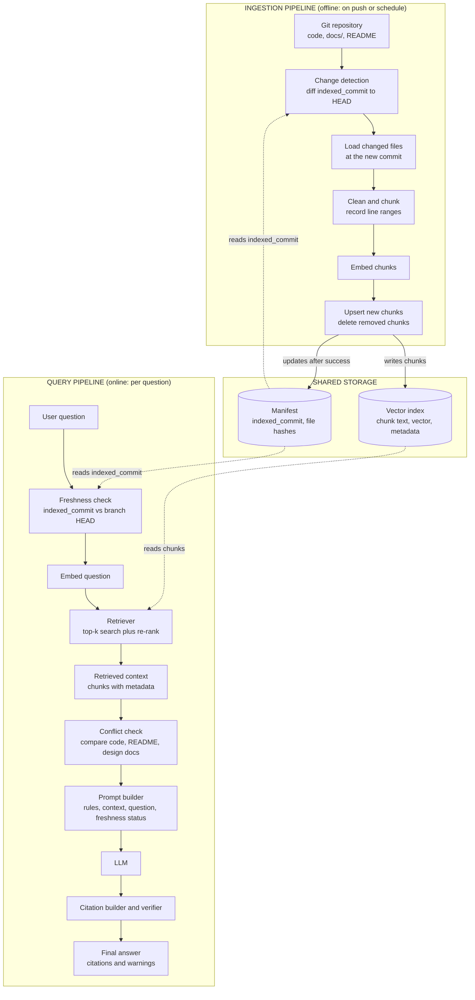

# Module 1 Architecture: Developer Knowledge & Codebase Assistant

> **Revision note (Task 2):** This version redesigns the architecture around reliability. It separates the ingestion and query pipelines, adds Git revision tracking, defines a citation format, specifies stale-index behaviour, and defines how conflicting sources are handled.

## Contents
1. [Problem Statement](#1-problem-statement)
2. [Architecture Diagram](#2-architecture-diagram)
3. [Git Revision Tracking and Change Detection](#3-git-revision-tracking-and-change-detection)
4. [Citation Format](#4-citation-format)
5. [Behaviour When the Index Is Stale](#5-behaviour-when-the-index-is-stale)
6. [Handling Conflicting Sources](#6-handling-conflicting-sources)
7. [Technique Selection](#7-technique-selection-rag-vs-prompt-engineering-vs-fine-tuning)
8. [Limitations and Failure Cases](#8-limitations-and-failure-cases)

---

## 1. Problem Statement

### The problem
Engineering knowledge is scattered. The answer to "how does authentication work here?" or "which environment variables does the service need?" lives across source files, READMEs, design documents, and past discussions. Developers, especially new joiners, spend a lot of time searching and reading to piece it together, and they interrupt teammates when they can't.

The **Developer Knowledge & Codebase Assistant** lets a developer ask questions in natural language and get answers grounded in the project's actual files, with verifiable references to where each answer came from.

### Who will use it
- **New team members** onboarding to the repository.
- **Existing developers** working in unfamiliar parts of the codebase.
- **Reviewers and maintainers** checking how something is documented or implemented.
- **Support or QA engineers** who need to understand behaviour without reading all the code.

### Why a normal chatbot may fail
A general-purpose LLM has never seen this private repository, so it:

1. **Lacks the knowledge.** Private code, internal docs, and recent commits are not in its training data.
2. **Hallucinates.** Asked about a function or config it doesn't know, it may confidently invent a plausible one.
3. **Is out of date.** Its knowledge is frozen at training time, while the repository changes daily.
4. **Cannot cite sources.** It can't point to the file, revision, and lines an answer came from, so the developer can't verify it.
5. **Has a limited context window.** Pasting an entire repository into every prompt is impractical and expensive.

Retrieval-Augmented Generation (RAG) addresses this by fetching the relevant pieces of the repository at question time and giving them to the LLM as evidence.

---

## 2. Architecture Diagram

The system has two pipelines that never run in the same flow:

- **Ingestion pipeline (offline):** runs on a push or schedule, reads the Git repository, and *writes* to the shared storage.
- **Query pipeline (online):** runs on every question and only *reads* from the shared storage.

The shared storage (vector index and manifest) is the only link between them.



*Solid arrows inside a pipeline are the data flow. The arrows labelled "writes" go from ingestion into storage; dotted arrows are reads from storage.*

### Ingestion pipeline stages

| Stage | What happens |
|---|---|
| Git repository | The knowledge source: source code, Markdown docs, and `sample_data/`, with files such as `.env` and `.venv/` excluded by an ignore list |
| Change detection | Compares the last indexed commit to the current commit to find added, modified, deleted, and renamed files (see [Section 3](#3-git-revision-tracking-and-change-detection)) |
| Load changed files | Reads only the changed files, at the exact new commit |
| Clean and chunk | Splits files into meaningful chunks (functions, classes, doc sections) and records each chunk's start and end line |
| Embed chunks | Converts each chunk to a vector with the embedding model |
| Upsert / delete | Inserts new chunks, removes outdated ones, and only then updates the manifest |

### Query pipeline stages

| Stage | What happens |
|---|---|
| Freshness check | Compares the indexed commit to the current branch HEAD (see [Section 5](#5-behaviour-when-the-index-is-stale)) |
| Embed question | Uses the same embedding model as ingestion |
| Retriever | Finds the top-k most similar chunks, optionally combined with keyword search and re-ranking |
| Retrieved context | The selected chunks plus metadata (path, revision, lines, source type) |
| Conflict check | Detects when different source types disagree (see [Section 6](#6-handling-conflicting-sources)) |
| Prompt builder | Combines instructions ("answer only from the context"), the context, the question, and the freshness and conflict status |
| LLM | Generates an answer from the supplied context |
| Citation builder and verifier | Attaches citations from retrieval metadata and checks them (see [Section 4](#4-citation-format)) |
| Final answer | The answer with citations and any warnings |

---

## 3. Git Revision Tracking and Change Detection

The index must always be able to say *which version of the repository it reflects*. Git gives us a reliable identifier for that: the **commit SHA**.

### What is tracked

**Manifest (one per indexed repository and branch):**

| Field | Purpose |
|---|---|
| `repo` and `branch` | Which repository and branch the index covers |
| `indexed_commit` | Full SHA of the commit the index currently reflects |
| `indexed_at` | When indexing last completed successfully |
| `status` | `complete`, `in_progress`, or `failed` |

**Metadata stored on every chunk:**

| Field | Purpose |
|---|---|
| `chunk_id` | Unique ID (e.g. from path, revision, and start line) |
| `file_path` | Path of the file within the repository |
| `commit_sha` | The commit this chunk was read from |
| `file_blob_sha` | Git's content hash for the file, used to confirm whether the file really changed |
| `start_line`, `end_line` | Line range of the chunk in that file at that commit |
| `source_type` | `code`, `readme`, `design_doc`, `test`, or `other` |
| `last_modified` | Date of the last commit that touched the file |

### How changes are detected

On each ingestion run, the pipeline asks Git for the list of changed files between the last indexed commit (`indexed_commit`) and the new commit (HEAD). Git's name-status diff classifies each file as Added, Modified, Deleted, or Renamed.

| Change | How it is detected | What the index does |
|---|---|---|
| **Addition** | File appears in the diff as *Added* (it exists at HEAD but not at `indexed_commit`) | Load the file, chunk, embed, and insert the new chunks with the new commit SHA |
| **Modification** | File appears as *Modified* and its blob SHA differs from the one stored on its chunks | Delete **all** old chunks for that path, then re-chunk, re-embed, and insert the new ones. Replacing the whole file avoids stale chunks whose line numbers have shifted |
| **Deletion** | File appears as *Deleted* (it existed at `indexed_commit` but not at HEAD) | Delete every chunk with that `file_path`. Nothing is re-embedded, so deleted code can no longer be retrieved |
| **Rename or move** | File appears as *Renamed* | Update `file_path` on its chunks. If the content also changed, treat it as a modification. This prevents a stale copy at the old path from being cited |

### Making the update safe
1. **Update the manifest last.** `indexed_commit` only moves to the new SHA after all upserts and deletes succeed. The manifest is marked `in_progress` during the run.
2. **A failed run leaves the old state intact.** The manifest still points to the old commit, so the next run re-processes the same diff.
3. **Re-running is safe.** Replacing chunks by file path gives the same result if run twice.
4. **Fallback to a full re-index** when the diff can't be trusted: the old commit is no longer in history (force-push or rebase), the chunking or embedding configuration changed, or the index is found to be inconsistent.
5. **Periodic check.** An occasional reconciliation compares the file list at HEAD with the file paths in the index to catch drift.

---

## 4. Citation Format

Every factual claim in an answer must be backed by a citation, so the developer can open the exact source and check it.

### Required fields

| Field | Meaning | Example |
|---|---|---|
| **File path** | Path relative to the repository root | `src/auth/token.py` |
| **Repository revision** | The commit SHA the text was read from (full SHA stored, short form shown) | `a1b2c3d` |
| **Line range** | First and last line of the supporting text at that revision | `L42-L58` |
| **Supporting text** | The exact, verbatim excerpt from those lines that supports the claim (shortened if long) | `def refresh_token(user): ...` |

### Display format

```text
[1] src/auth/token.py @ a1b2c3d, L42-L58
    "def refresh_token(user): ... expires_in = 3600"
```

The same citation as structured data (for the UI or logs):

```json
{
  "file_path": "src/auth/token.py",
  "revision": "a1b2c3d4e5f6...",
  "start_line": 42,
  "end_line": 58,
  "supporting_text": "def refresh_token(user): ... expires_in = 3600",
  "source_type": "code"
}
```

### Rules
1. **Citations come from metadata, not from the LLM.** The LLM refers to numbered context chunks; the system fills in the path, revision, and lines from the stored metadata. This prevents the model from inventing file names or line numbers.
2. **Supporting text must be verbatim.** The system checks that the quoted text actually appears in the retrieved chunk, and removes or flags the citation if it doesn't.
3. **One claim, at least one citation.** A statement with no supporting chunk is removed or marked "not supported by the repository".
4. **Line numbers refer to the cited revision.** If the file has since changed, the line range may no longer match HEAD, which is why the revision is always shown (see [Section 5](#5-behaviour-when-the-index-is-stale)).
5. **Optional permalink.** The UI can link to the file at that exact commit and line range, so it always opens the version that was cited.
6. **Source type is shown** (code, README, design doc), so the reader knows how much weight to give each source.

---

## 5. Behaviour When the Index Is Stale

### Definition
The index is **stale** when `indexed_commit` is not the current HEAD of the tracked branch, meaning commits exist that the index hasn't processed.

Being stale does not always make an answer wrong. What matters is whether the files behind the answer changed. So the system checks both things on every query: (1) is the index behind HEAD, and (2) did any file used in the answer change between `indexed_commit` and HEAD.

### Responses

| Situation | Behaviour |
|---|---|
| **Fresh:** `indexed_commit` equals HEAD | Answer normally. Show the revision in citations. |
| **Stale, but none of the retrieved files changed** | Answer normally, with a short note: "Index is N commits behind HEAD; the files used in this answer are unchanged." |
| **Stale, and one or more retrieved files changed** | Show a **prominent warning** at the top: the answer is based on revision `a1b2c3d`, current HEAD is `f9e8d7c`, and list the changed files. Present the answer as "as of `a1b2c3d`", not as current behaviour. |
| **Stale, and a retrieved file was deleted or renamed** | Do not present it as existing. State that the file was removed or moved at HEAD (and where, if renamed). |
| **Index far behind, failed, or in an unknown state** (e.g. more than a set number of commits or days behind, `status` is `failed`, or HEAD can't be checked) | Do not give a confident answer. Tell the user the index is unreliable, give the last known good revision, and offer only a clearly labelled best-effort answer. |

### Actions the system takes
1. **Trigger a refresh** in the background whenever staleness is detected, so later questions are answered from a fresh index.
2. **Offer a re-ask** once indexing finishes ("The index has been updated, ask again for an up-to-date answer").
3. **Optionally verify against HEAD:** for a small number of changed files, read the current file directly from Git and compare it with the indexed chunk. Report whether the cited lines still match.
4. **Log every stale response** (revision gap, files affected) so the team can monitor how often it happens and tune the refresh schedule or a push-triggered update.

---

## 6. Handling Conflicting Sources

### Why conflicts happen
A repository contains different *kinds* of sources that describe the same thing from different angles and change at different speeds:

| Source | What it is good evidence for | Typical weakness |
|---|---|---|
| **Source code** | What the system **actually does** right now | Doesn't explain intent; the code may itself contain a bug |
| **Official design documents** | What the system is **supposed to do** and why (intent, requirements, decisions) | Often written once and not updated; may describe a plan that was never built |
| **README files** | How to **set up and use** the project | Easily becomes outdated, often written informally |

None of these is always right. The system must not pick one by default; it must decide based on **the type of question** and **the evidence**, and be open when it can't resolve a conflict.

### Principle: authority depends on the question

| Question type | Primary evidence | Supporting evidence |
|---|---|---|
| "What does the system do?" / "What happens when...?" | **Code** (and tests) | Design docs, README for context |
| "What is it supposed to do?" / "Why was it designed this way?" | **Design documents** | Code to show whether it was implemented |
| "How do I install, configure, or run it?" | **README**, checked against config files and code | Design docs |

### Detection
During retrieval, the system keeps chunks from different `source_type` values and flags a **possible conflict** when:
- chunks from different source types cover the same topic (same function, setting, endpoint, or concept), and
- their statements differ (a different value, behaviour, name, or step).

Comparison can be done by instructing the LLM to compare the retrieved chunks explicitly and list any disagreements, together with simple checks such as matching config keys, function names, and numeric values.

### Resolution steps
1. **Identify the question type** to decide which source is the primary evidence.
2. **Gather all relevant sources** and compare their claims, not just the top-ranked one.
3. **Check supporting signals:** `last_modified` dates, tests that assert the behaviour, and the document's status (e.g. approved or draft). A newer, tested source is stronger; an old document describing a different version is weaker.
4. **State the conflict openly** rather than silently choosing. Show what each source says, with a citation for each.
5. **Give a reasoned conclusion,** clearly separated from the facts: "For current behaviour, the code is the better evidence. The README appears outdated."
6. **If it can't be resolved** (e.g. the code looks like a bug against the design doc, or the dates are unclear), say so and recommend confirming with the module owner. Don't pick one.
7. **Suggest a fix:** flag the mismatch as a possible documentation bug or code bug so it can be raised.

### Example answer format

```text
Conflict found: the token expiry differs between sources.

- Code: tokens expire after 3600 s (1 hour)
  [1] src/auth/token.py @ a1b2c3d, L42-L58
- README: states 24 hours
  [2] README.md @ a1b2c3d, L88-L90  (last changed 8 months ago)
- Design doc: specifies 1 hour
  [3] docs/auth-design.md @ a1b2c3d, L12-L15  (status: approved)

Assessment: the code and the design doc agree on 1 hour, and the README
appears outdated. Current behaviour is most likely 1 hour. Consider updating
the README.
```

### What the system must not do
- Always trust the README, or always trust the code.
- Merge the contradicting statements into one smooth answer that hides the disagreement.
- Present an unresolved conflict with a confident tone.

---

## 7. Technique Selection: RAG vs Prompt Engineering vs Fine-tuning

These techniques solve different problems, and they are often combined.

### Prompt engineering
**Use when** the model already has the needed knowledge and you only need to control *how* it responds: format, tone, role, constraints, or reasoning steps. It is the cheapest and fastest option and should be tried first.

**Example:** Writing a prompt that makes an LLM act as a code reviewer and return feedback in a fixed structure (issue, severity, suggested fix) for a pasted diff. No new knowledge is needed, only clear instructions.

### RAG (Retrieval-Augmented Generation)
**Use when** the answer depends on **external, private, or frequently changing information** that the model doesn't have, and you need grounded, citable answers. Updating knowledge only requires re-indexing, not retraining.

**Example:** This project: a developer asks "How does our payment service retry failed requests?" The system retrieves the relevant code and docs from the repository and the LLM answers from them, citing the files.

### Fine-tuning
**Use when** you need to change the model's *behaviour or style* consistently, or teach it a specialised task or format, and you have a good set of training examples. It is not a good way to add facts that change often.

**Example:** Fine-tuning a model on thousands of the company's past (code, commit message) pairs so it generates commit messages in the team's exact conventions, or fine-tuning a small model to convert natural language into the company's internal query language.

### Quick comparison

| | Prompt engineering | RAG | Fine-tuning |
|---|---|---|---|
| Solves | How the model responds | What the model knows | How the model behaves or specialises |
| Handles private or changing data | No | Yes | Poorly |
| Setup cost | Very low | Medium | High |
| Update cost | Edit the prompt | Re-index | Retrain |
| Provides citations | No | Yes | No |

**For this project:** RAG is the core technique (the repository is private and changes constantly), supported by prompt engineering (to enforce grounded, cited answers and conflict reporting). Fine-tuning is not needed at this stage.

---

## 8. Limitations and Failure Cases

| # | Failure case | Why it happens | How the system should respond |
|---|---|---|---|
| 1 | **Stale index** | Code or docs changed after the last ingestion | Detect via `indexed_commit` vs HEAD, warn when affected files changed, trigger a refresh. See [Section 5](#5-behaviour-when-the-index-is-stale). |
| 2 | **Missing relevant code** | The file was never indexed, was chunked badly, or ranked too low by the retriever | If retrieval confidence is low, say no strong match was found instead of guessing. Suggest naming a file or module. Improve with better chunking, hybrid (keyword + vector) search, or re-ranking. |
| 3 | **Unsupported or hallucinated answer** | The LLM fills gaps from its own memory when the context is weak | Instruct the model to answer only from context and say "I don't know based on the repository" otherwise. Verify citations and drop claims with no supporting chunk. See [Section 4](#4-citation-format). |
| 4 | **Conflicting sources** | Code, README, and design documents disagree | Show each source with citations, weigh them by question type, and state the conclusion separately. See [Section 6](#6-handling-conflicting-sources). |
| 5 | **Sensitive data exposure** | Secrets (API keys, `.env` values) get indexed and retrieved | Exclude such files at ingestion, scan for secrets before indexing, and never return them in answers. |
| 6 | **Whole-repository questions** | Top-k chunks can't capture cross-file questions like "summarise the full architecture" | Detect broad questions, retrieve from higher-level docs first, and be clear that the answer covers only the retrieved parts. |
| 7 | **Index inconsistency after a failed or interrupted run** | Ingestion crashed halfway, or history was rewritten (force-push) | Keep the manifest on the last good commit, re-process the same diff, and fall back to a full re-index when the old commit is missing. See [Section 3](#3-git-revision-tracking-and-change-detection). |

### Guiding principle
When the system is unsure, it should **say so and show its evidence**, never present a guess as fact.