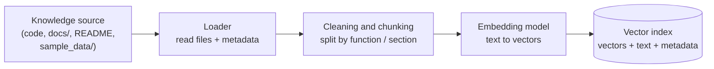
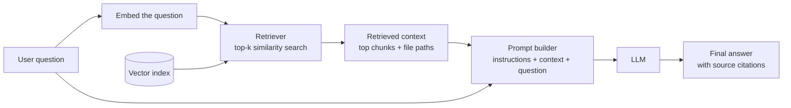

# Module 1 Architecture: Developer Knowledge & Codebase Assistant

## 1. Problem Statement

### The problem
Engineering knowledge is scattered. The answer to "how does authentication work here?" or "which env variables does the service need?" lives across source files, READMEs, design docs, and past discussions. Developers, especially new joiners, spend a lot of time searching and reading to piece it together, and they interrupt teammates when they can't.

The **Developer Knowledge & Codebase Assistant** lets a developer ask questions in natural language and get answers grounded in the project's actual files, with references to where each answer came from.

### Who will use it
- **New team members** onboarding to the repository.
- **Existing developers** working in unfamiliar parts of the codebase.
- **Reviewers and maintainers** who want to check how something is documented or implemented.
- **Support or QA engineers** who need to understand behaviour without reading all the code.

### Why a normal chatbot may fail
A general-purpose LLM has never seen this private repository, so it:

1. **Lacks the knowledge.** Private code, internal docs, and recent commits are not in its training data.
2. **Hallucinates.** Asked about a function or config that doesn't exist in its memory, it may confidently invent a plausible one.
3. **Is out of date.** Its knowledge is frozen at training time, while the repository changes daily.
4. **Cannot cite sources.** It can't point to the file and line an answer came from, so the developer can't verify it.
5. **Has a limited context window.** Pasting an entire repository into every prompt is impractical and expensive.

Retrieval-Augmented Generation (RAG) addresses this by fetching the relevant pieces of the repository at question time and giving them to the LLM as evidence.

---

## 2. Architecture Diagram

The system has two separate workflows: **ingestion** (offline, run when the repo changes) and **query** (online, run on every question).

### 2.1 Ingestion workflow (indexing pipeline)

| Stage | What happens |
|---|---|
| Knowledge source | Source files, Markdown docs, and sample data in the repository |
| Loader | Reads files and records metadata (file path, language, last modified, commit) |
| Cleaning and chunking | Removes noise and splits content into meaningful chunks (e.g. per function or doc section) with some overlap |
| Embedding model | Converts each chunk into a vector that captures its meaning |
| Vector index | Stores vectors alongside the original text and metadata for fast similarity search |

### 2.2 Query-time workflow

| Stage | What happens |
|---|---|
| User question | A developer asks something like "Where is the database connection configured?" |
| Embed the question | The same embedding model used at ingestion converts the question to a vector |
| Retriever | Finds the top-k most similar chunks in the index (optionally with filters or re-ranking) |
| Retrieved context | The selected chunks, with their file paths, are the evidence for the answer |
| Prompt builder | Combines system instructions ("answer only from the context; say so if it's not there"), the context, and the question |
| LLM | Generates an answer based on the supplied context |
| Final answer | A response that cites the source files so the developer can verify it |

---

## 3. Technique Selection: RAG vs Prompt Engineering vs Fine-tuning

These techniques solve different problems, and they are often combined.

### Prompt engineering
**Use when** the model already has the needed knowledge and you only need to control *how* it responds: format, tone, role, constraints, or reasoning steps. It is the cheapest and fastest option and should be tried first.

**Example:** Writing a prompt that makes an LLM act as a code reviewer and return feedback in a fixed structure (issue, severity, suggested fix) for a pasted diff. No new knowledge is needed, only clear instructions.

### RAG (Retrieval-Augmented Generation)
**Use when** the answer depends on **external, private, or frequently changing information** that the model doesn't have, and you need grounded, citable answers. Updating knowledge only requires re-indexing, not retraining.

**Example:** This project: a developer asks "How does our payment service retry failed requests?" The system retrieves the relevant code and docs from the repository and the LLM answers from them, citing the files.

### Fine-tuning
**Use when** you need to change the model's *behaviour or style* consistently, or teach it a specialised task or format, and you have a good set of training examples. It is not a good way to add facts that change often.

**Example:** Fine-tuning a model on thousands of the company's past (code, commit message) pairs so it generates commit messages in the team's exact conventions, or fine-tuning a small model to convert natural language into the company's internal query DSL.

### Quick comparison

| | Prompt engineering | RAG | Fine-tuning |
|---|---|---|---|
| Solves | How the model responds | What the model knows | How the model behaves or specialises |
| Handles private or changing data | No | Yes | Poorly |
| Setup cost | Very low | Medium | High |
| Update cost | Edit the prompt | Re-index | Retrain |
| Provides citations | No | Yes | No |

**For this project:** RAG is the core technique (the repository is private and changes constantly), supported by prompt engineering (to enforce grounded, cited answers). Fine-tuning is not needed at this stage.

---

## 4. Limitations and Failure Cases

| # | Failure case | Why it happens | How the system should respond |
|---|---|---|---|
| 1 | **Stale index** | Code or docs changed after the last ingestion, so retrieved chunks describe old behaviour | Store the last-indexed commit or timestamp in chunk metadata and show it with the answer. Re-index on a schedule or on each push (incremental updates). If a source file is newer than its indexed version, warn the user the answer may be outdated. |
| 2 | **Missing relevant code** | The needed file was never indexed, was chunked badly, or the retriever ranked it too low | If retrieval confidence is low, say that no strong match was found rather than guessing. Suggest rephrasing or naming a file or module. Improve with better chunking, hybrid (keyword + vector) search, or re-ranking. |
| 3 | **Unsupported or hallucinated answer** | The LLM fills gaps from its own memory when the context is weak or irrelevant | Instruct the model to answer only from the provided context and to say "I don't know based on the repository" otherwise. Require citations for every claim, and drop or flag claims with no supporting chunk. |
| 4 | **Conflicting sources** | A README says one thing while the code does another | Surface both sources, prefer the code as the source of truth, and note the discrepancy instead of silently choosing one. |
| 5 | **Sensitive data exposure** | Secrets (API keys, `.env` values) get indexed and then retrieved | Exclude files such as `.env` and `.venv` at ingestion (via an ignore list), scan for secrets before indexing, and never return them in answers. |
| 6 | **Questions needing whole-repo reasoning** | Top-k chunks can't capture cross-file questions like "summarise the full architecture" | Detect broad questions, retrieve from higher-level docs first, and be clear that the answer covers only the retrieved parts. |

### Guiding principle
When the system is unsure, it should **say so and show its evidence**, never present a guess as fact.